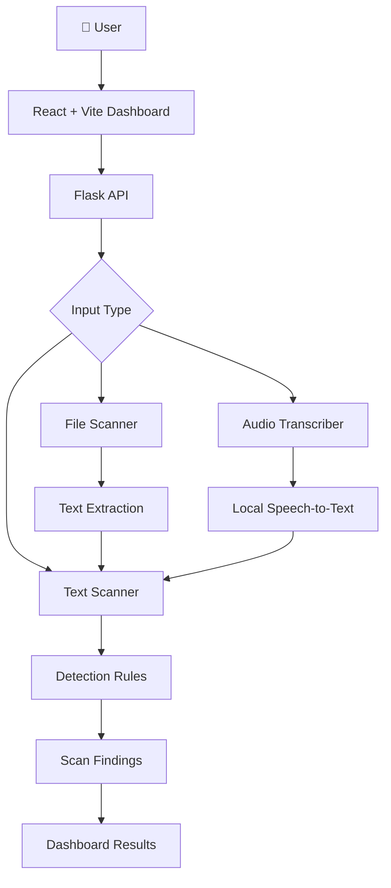

# 🛡️ JailbreakGuard AI

### AI-Powered Prompt Injection & Jailbreak Detection Platform

<p align="center">
  <strong>Inspect. Detect. Understand. Protect.</strong>
  <br />
  A local-first security dashboard that analyzes text, documents, and audio transcripts for suspicious prompt-injection and jailbreak indicators.
</p>

<p align="center">
  
  
  
  
  
</p>

<p align="center">
  <a href="https://github.com/NIKHILKAKADEK/JailbreakGuard">Repository</a> •
  <a href="#-features">Features</a> •
  <a href="#-architecture">Architecture</a> •
  <a href="#-installation">Installation</a> •
  <a href="#-testing">Testing</a>
</p>

---

## 🚀 Overview

**JailbreakGuard** is a cybersecurity project designed to identify suspicious instructions and potential prompt-injection patterns in user-provided content.

It combines a React dashboard with a Python Flask backend and a transparent rule-based scanning engine.

The application can inspect text, extract content from supported documents, and scan audio by transcribing it locally before checking the transcript.

Rather than treating every match as a confirmed attack, JailbreakGuard presents findings as indicators for human review.

### 🎯 Why JailbreakGuard?

As AI applications become more common, prompt injection and jailbreak attempts create new security challenges.

JailbreakGuard explores how a transparent detection system can help identify suspicious instructions before they are used in an AI workflow.

---

## ✨ Features

| Feature | Description |
|---|---|
| 🔍 Text Scanning | Analyze text for suspicious jailbreak and prompt-injection indicators |
| 📄 File Scanning | Extract and inspect content from supported document formats |
| 🎧 Audio Scanning | Transcribe audio locally and scan the resulting transcript |
| 🧠 Rule-Based Detection | Uses readable detection patterns in `scanner.py` |
| 📊 Evaluation Reports | Generate benchmark metrics and error-analysis reports |
| 🤖 ML Experiment | Optional TF-IDF + Logistic Regression comparison |
| 🧪 Automated Tests | Backend tests using Pytest |
| 🔒 Local Processing | Submitted content is processed locally in memory for the current request |
| 📱 Dashboard | React-based interface with session history |

---

## 🖥️ Dashboard Preview

> Add screenshots of your actual application here.

<p align="center">
  
</p>

**To add your screenshot:**
1. Create a folder named `docs/images/`.
2. Save your dashboard screenshot as `dashboard.png`.
3. Upload it to GitHub.

Until you add the screenshot, this image placeholder will not display.

---

## 🏗️ Architecture

JailbreakGuard uses a simple frontend-to-backend architecture.



### 🔄 How It Works

1. The user submits text or uploads a supported file.
2. The React frontend sends the request to the Flask backend.
3. The backend validates the input.
4. Documents are processed by the file extraction module; audio is transcribed through the optional local transcription pipeline.
5. Extracted text is passed to the detection engine.
6. The scanner checks for configured suspicious patterns.
7. Findings are returned to the dashboard for human review.

---

## 🧰 Tech Stack

| Layer | Technology |
|---|---|
| Frontend | React |
| Development Server | Vite |
| Backend | Python, Flask |
| Detection Engine | Python, Regular Expressions |
| Optional ML Experiment | Scikit-learn, TF-IDF, Logistic Regression |
| Document Processing | pypdf, python-docx, python-pptx, openpyxl |
| XML Security | defusedxml |
| Audio Transcription | faster-whisper, PyAV |
| Testing | Pytest |
| Dataset Processing | PyArrow |

---

## 🔍 Supported Input Formats

### Text and Documents

`TXT` `MD` `PDF` `DOCX` `PPTX` `XLSX` `JSON` `XML` `HTML` `HTM`

### Images

`PNG` `JPG` `JPEG`

Image OCR is optional and requires locally installed Tesseract OCR.

### Audio

`WAV` `MP3` `M4A` `FLAC`

Audio uploads are limited to 10 MB and five minutes by default.

---

## ⚙️ Installation

### Prerequisites

Install the following before starting:

- Python 3.12
- Node.js and npm
- Git
- Visual Studio Code (recommended)

### 1. Clone the repository

```bash
git clone https://github.com/NIKHILKAKADEK/JailbreakGuard.git
cd JailbreakGuard
```

### 2. Create a Python virtual environment

```cmd
python -m venv .venv
```

Activate it:

```cmd
.venv\Scripts\activate
```

### 3. Install backend dependencies

```cmd
python -m pip install -r requirements.txt
```

### 4. Start the Flask backend

```cmd
python app.py
```

The Flask API runs locally at:

`http://127.0.0.1:5000`

### 5. Install frontend dependencies

Open a **second CMD window**:

```cmd
cd frontend
npm install
```

### 6. Start the React frontend

```cmd
npm run dev
```

Open your browser:

**http://localhost:5173**

Keep both servers running while using the dashboard.

---

## 🔌 API Endpoints

The Flask backend currently provides these endpoints:

| Method | Endpoint | Purpose |
|---|---|---|
| POST | `/scan` | Scan submitted text |
| POST | `/scan-file` | Upload and scan a supported file |
| POST | `/scan-audio` | Transcribe and scan an audio upload |

The React development server forwards `/scan` and `/scan-file` requests to Flask through its Vite proxy configuration.

---

## 🧪 Testing

JailbreakGuard includes automated backend tests.

Run the test suite:

```cmd
python -m pytest -q
```

Build the frontend:

```cmd
cd frontend
npm run build
```

These commands help verify backend tests and frontend compilation. They do not replace real-world security testing.

---

## 📊 Dataset Evaluation

The project includes an optional offline dataset evaluator that uses the production `scanner.scan_text()` function.

It supports:
- Train, validation, and test evaluation.
- Accuracy, precision, recall, and F1-score.
- False-positive and false-negative rates.
- Confusion matrix.
- Category-level metrics.
- Dataset overlap inspection.

Example:

```cmd
python scripts/evaluate_dataset.py --dataset core --split test
```

Run a deterministic sample:

```cmd
python scripts/evaluate_dataset.py --dataset full --split test --max-samples 500 --seed 2026 --output reports\full_test_500.json
```

### Optional ML Comparison

The project also contains an experimental TF-IDF + Logistic Regression pipeline.

It compares:
- Rules-only predictions.
- ML-only predictions.
- OR-hybrid predictions.

Run:

```cmd
python scripts/analyze_rules.py --output reports\core_train_error_analysis.json
python scripts/evaluate_models.py --output reports\core_validation_models.json
```

**Important:** Validation results are model-selection evidence, not proof of real-world protection. Dataset partitions can contain overlap, so benchmark results must be interpreted carefully.

---

## 🔐 Privacy & Security

JailbreakGuard is designed for local processing.

- Submitted text and uploaded content are processed in memory for the current request.
- Uploaded files are not saved by the application.
- Prompt and extracted content are not logged.
- The application does not make external API calls for ordinary scanning.
- XML external entities are disabled.
- HTML scripts and styles are ignored during extraction.
- XLSX formulas and macros are not executed.
- Audio transcripts are not returned or logged.

**Audio model note:** On first use, faster-whisper may download model weights from Hugging Face. Audio processing is local, but downloading model weights requires network access.

---

## ⚠️ Limitations

JailbreakGuard is an experimental detection and analysis tool.

- A detected pattern is an indicator for review, not proof of a malicious prompt.
- No detection does not guarantee that content is safe.
- Rule-based scanning cannot identify every possible attack.
- ML results from local datasets do not establish production-grade security.
- Audio transcription accuracy has not been verified using a real-world benchmark in this project.
- This application is not a complete AI firewall or forensic audio authentication system.

Do not use it as the sole security control for a production AI system.

---

## 📁 Project Structure

```text
JailbreakGuard/
│
├── app.py
├── scanner.py
├── file_scanner.py
├── audio_transcriber.py
│
├── frontend/
│   ├── src/
│   │   ├── App.jsx
│   │   ├── main.jsx
│   │   └── styles.css
│   ├── index.html
│   ├── package.json
│   └── vite.config.js
│
├── scripts/
│   ├── analyze_rules.py
│   ├── evaluate_dataset.py
│   └── evaluate_models.py
│
├── reports/
│
├── tests/
│
├── templates/
├── static/
│
├── test_samples/
├── requirements.txt
├── README.md
└── .gitignore
```

The older `templates/` and `static/` files are retained as reference files from the original Flask interface. Flask no longer serves the React dashboard through those files.

---

## 🛣️ Future Improvements

Potential directions for future development:

- [ ] More advanced prompt-injection detection techniques.
- [ ] Improved detection of obfuscated and indirect instructions.
- [ ] Better detection evaluation across diverse datasets.
- [ ] More detailed explanations for individual detection rules.
- [ ] Improved dashboard visualizations.
- [ ] Expanded security testing and adversarial evaluation.
- [ ] Integration with AI application security workflows.

---

## 👨‍💻 Author

**Nikhil Kakade**

B.Tech — Artificial Intelligence & Data Science

Interested in AI Security, Cybersecurity, Machine Learning, and Software Development.

<p align="center">
  <a href="https://github.com/NIKHILKAKADEK">
    
  </a>
</p>

---

<p align="center">
  <strong>🛡️ JailbreakGuard — Making AI interactions easier to inspect.</strong>
  <br />
  Built as an AI and cybersecurity portfolio project.
</p>
